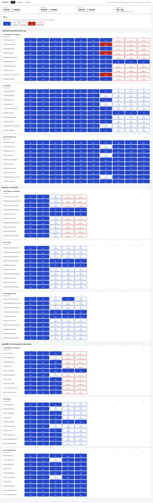

# Savepoint

Checkpoint, verify and roll back AI agents working on legacy GUI applications.

Computer-use agents drive apps that have no API. When they fail halfway, or say "done" when the state is wrong,
nothing undoes the damage. Savepoint adds a transaction layer around the agent: it checkpoints before risky
steps, checks a goal contract when the agent says "done", rolls back on failure or false completion, and proves
each restore exact with a state diff.



<!-- RESULTS:START -->
## Results (scripted agent, not a language model)

A **scripted fault-injecting agent** drives each app: it follows a golden click path and, on a fixed schedule,
stops midway, types a wrong value, skips the final save or claims done early. The same fault hits every arm.
Arm B is the baseline with no Savepoint, S is Savepoint with atomic rollback, R adds retry from the last good
checkpoint. These numbers show what the runtime does with a known failure mix. **They say nothing about how
reliable any model is.**

### ClaimDesk 98 (synthetic claims app, built here): 300 runs

| Arm | N | Valid success | Atomicity (Wilson 95%) | False done (IS) | Dirty fail (IF) |
|---|---|---|---|---|---|
| B | 100 | 70.0% | 70.0% (60.4% to 78.1%) | 27 | 3 |
| R | 100 | 97.0% | 100.0% (96.3% to 100.0%) | 0 | 0 |
| S | 100 | 70.0% | 100.0% (96.3% to 100.0%) | 0 | 0 |

False `done` claims caught in arm S: 25 of 25 (100.0%); true claims flagged: 0 of 70. Restores exact: 60 of 60. Checkpoint p95 47 ms, restore p95 94 ms.

### iDempiere (real ERP, Docker): 150 runs

| Arm | N | Valid success | Atomicity (Wilson 95%) | False done (IS) | Dirty fail (IF) |
|---|---|---|---|---|---|
| B | 50 | 52.0% | 68.0% (54.2% to 79.2%) | 16 | 0 |
| R | 50 | 54.0% | 100.0% (92.9% to 100.0%) | 0 | 0 |
| S | 50 | 52.0% | 100.0% (92.9% to 100.0%) | 0 | 0 |

False `done` claims caught in arm S: 16 of 16 (100.0%); true claims flagged: 0 of 26. Restores exact: 63 of 63. Checkpoint p95 131 ms, restore p95 610 ms.

### OpenMRS 2.12 (real hospital record system, Docker): 150 runs

| Arm | N | Valid success | Atomicity (Wilson 95%) | False done (IS) | Dirty fail (IF) |
|---|---|---|---|---|---|
| B | 50 | 60.0% | 64.0% (50.1% to 75.9%) | 18 | 0 |
| R | 50 | 96.0% | 100.0% (92.9% to 100.0%) | 0 | 0 |
| S | 50 | 60.0% | 100.0% (92.9% to 100.0%) | 0 | 0 |

False `done` claims caught in arm S: 18 of 18 (100.0%); true claims flagged: 0 of 30. Restores exact: 40 of 40. Checkpoint p95 71 ms, restore p95 529 ms.

600 runs in total. Full tables, pass^k and sample sizes: [docs/results.md](docs/results.md). Acceptance status per check: [docs/validation.md](docs/validation.md).

<!-- RESULTS:END -->

## Quick start

```bash
uv sync && uv run playwright install chromium
uv run pytest -q                                   # 60 tests, no model calls
uv run python -m savepoint.bench.cli run           # ClaimDesk: 300 runs, resumable, ~10 min
uv run python -m savepoint.bench.cli report        # docs/results.md + results.json
make export && make console                        # open http://localhost:8080
```

Real apps need Docker (any machine, or a free GitHub Codespace):

```bash
docker compose -f apps/openmrs/compose.yml up -d && sh apps/openmrs/disable-cache.sh     # wait ~3 min
uv run python scripts/realapp.py openmrs seed          # register the patient cast, freeze the baseline
uv run python -m savepoint.bench.cli run --app openmrs # 150 runs
docker compose -f apps/idempiere/compose.yml up -d     # iDempiere, same pattern (stop OpenMRS first: port 8080)
uv run python -m savepoint.bench.cli run --app idempiere
```

## How rollback works

1. S0 is checkpointed before step 1: the monitored database tables (SQLite backup, or a consistent read for MySQL and PostgreSQL), file-volume tar, browser storage state, URL.
2. Before any click on a risky control (Save, Delete, OK...) another checkpoint is taken, unless nothing changed since the last one.
3. After each state-changing step the contract invariants run.
4. When the agent reports `done`, goal and frame checks run. The frame check removes every change the contract allows; anything left is an unexpected change.
5. On failure the checkpoint is restored and the digest compared column by column. Any difference means `rollback_failed` and quarantine.

## Contract language

YAML with `invariants`, `goal` (SQL plus one of ten operators), `frame` (`unchanged` tables and an allowed-change
list) and up to three `screen` checks. See [docs/contracts.md](docs/contracts.md) and `workflows/` (30 contracts: ClaimDesk, OpenMRS, iDempiere).

## Limits

Sandbox apps only (`SANDBOX_ONLY=true` refuses any other host). Snapshots work at the database and file level,
so apps with external side effects (email, payments) are out of scope. Data is synthetic or the apps' public demo data. Changes to tables outside a contract's monitored set are neither digested nor restored. The agent in every benchmark is scripted, not a model.
The oracle and the validators are separate modules (an import-lint test enforces it).

## Prior work

Outcome classes and atomicity follow LegacyWorld (arXiv 2608.14131). Related: legacy-use, TClone, DART, AgentRewind.
Atomicity, rollback and pass^k are not novel here; the contribution is the combination and the exactness proof.

## Security

No real credentials or data. Screenshots are redacted before any write (`export/redact.py` is the only image
writer). No model call runs in tests or CI.

MIT licence.
